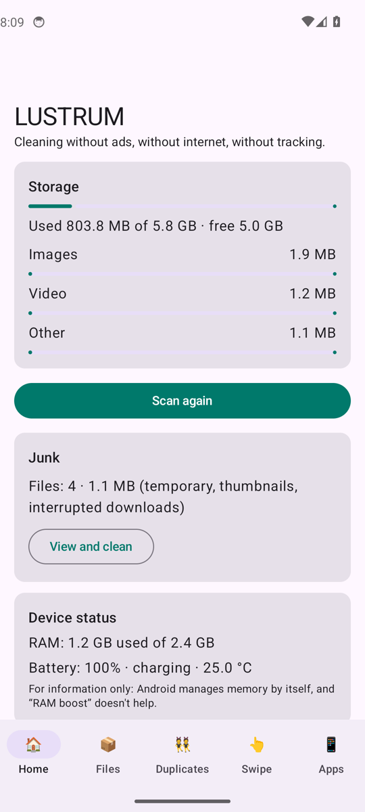
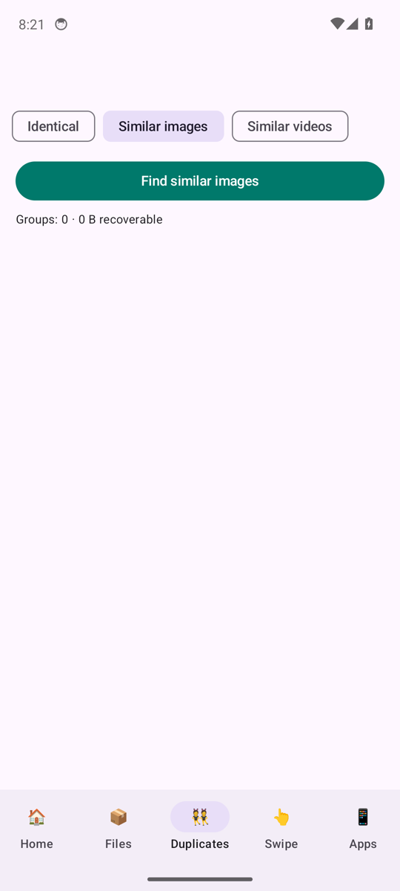
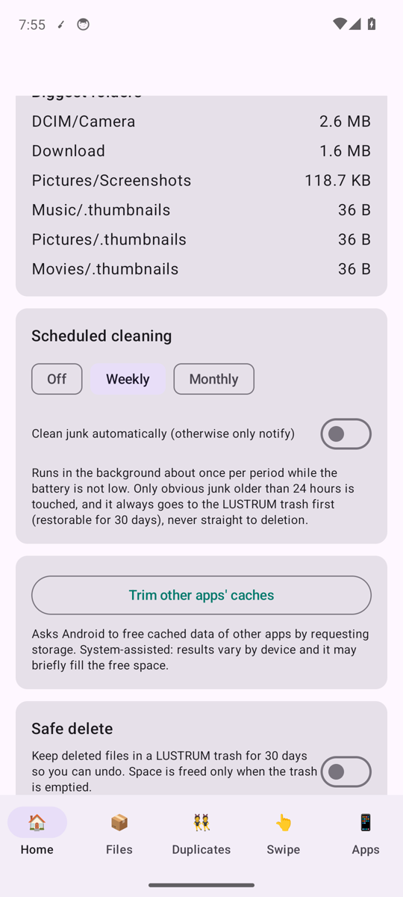

[English](README.md) · [Română](README.ro.md) · [Français](README.fr.md) · [Italiano](README.it.md) · [Español](README.es.md) · [Português](README.pt.md) · [Deutsch](README.de.md) · **Magyar**

# LUSTRUM

> **Vedd vissza a telefonod. Semmi nem hagyja el.**

A LUSTRUM megtalálja a felesleges fájlokat, duplikátumokat, hasonló fotókat és az alkalmazások maradványait, és csak a jóváhagyásoddal törli őket. Nincs INTERNET-engedélye, így fizikailag sem tud semmit sehová küldeni.

**Verzió: 0.8.0 · Utolsó frissítés: 2026-11-26**

[lustrum.chiuta.ro/](https://lustrum.chiuta.ro/)

## Mit tud

- **Tárhely egy pillantásra** — Használt és szabad hely, képekre, videókra, hangra, dokumentumokra és archívumokra bontva.
- **Nagy, régi és felesleges fájlok** — 50 MB feletti, egy éve érintetlen, ideiglenes fájlok, bélyegképek, kuka és megszakadt letöltések.
- **Pontos duplikátumok** — Méret, majd gyors ujjlenyomat, majd teljes SHA-256 alapján. Alapértelmezés szerint a legrégebbi másolat marad.
- **Hasonló fotók** — Az észlelési hash megtalálja az átméretezett, újramentett és ismételt felvételeket, láncolás nélkül csoportosítva. Te nézed át a csoportokat; alapból a legnagyobb másolat marad meg.
- **Alkalmazásmaradványok** — Régen eltávolított alkalmazások hátrahagyott mappái, valamint az üres mappák.
- **Fotótömörítés** — Újrakódolja a nagy JPEG-eket, és csak akkor cseréli le őket, ha az eredmény legalább 20%-kal kisebb. Az EXIF megmarad; a mozgó fényképeket és a HDR-felvételeket kihagyja.
- **Alkalmazások, gyorsítótárak, nem használtak** — Alkalmazásonkénti gyorsítótár-méret, utolsó használat dátuma, közvetlen ugrás a beállításokhoz vagy az eltávolításhoz.
- **Eszközállapot** — RAM, akkumulátorszint és hőmérséklet — csak olvasható, tájékoztató jellegű.
- **Elmosódott és sötét fotók** — Minden fotó kis másolatán méri az élességet és a fényerőt, és listázza a valószínű selejtet, hogy átnézhesd.
- **Biztonságos törlés visszavonással** — Opcionális LUSTRUM-kuka: a törölt fájlok 30 napig várnak és visszaállíthatók; a hely ürítéskor szabadul fel.
- **Előnézetek és legnagyobb mappák** — Bélyegképek minden listában, rangsor a legtöbb helyet foglaló mappákról és az eddig felszabadított összeg.
- **Swiper** — Lapozz végig a fotókon és videókon egyesével, a legrégebbiekkel kezdve: balra húzva törlöd, jobbra húzva megtartod. A végső megerősítésig semmi nem törlődik.
- **Ütemezett tisztítás** — Hetente vagy havonta, a háttérben, megfelelő akkumulátorszintnél: értesítés, vagy csak a 24 óránál régebbi, egyértelműen felesleges fájlok automatikus törlése. A megtisztított fájlok mindig előbb a 30 napos LUSTRUM-kukába kerülnek.
- **Legjobb fotó és hasonló videók** — A hasonló fotók csoportjaiban a legélesebb másolatot javasolja először. A hasonló videókat egy középső képkocka és a közel azonos hossz alapján párosítja.
- **Rendszer által segített gyorsítótár-csökkentés** — Az Androidot kéri, hogy tárhely igénylésével szabadítsa fel más alkalmazások gyorsítótárát. Az eredmény eszközfüggő; root-varázslat nincs. Rootolt telefonokon rootot is használ az összes gyorsítótár törléséhez.

## Működés közben

Valódi képernyőképek és felvételek a LUSTRUM-ról egy Android-emulátoron, generált mintafájlokkal — nem fizikai telefonon.

**Rövid bemutatóvideók:** [▶ A telefon vizsgálata](media/scan.mp4) · [▶ Duplikátumok keresése](media/dupes.mp4) · [▶ Swiper működés közben](media/swiper.mp4) · [▶ Automatikus tisztítás ütemezése](media/schedule.mp4)

## Magánszféra-barát felépítés

A legtöbb tisztító reklámokból és adatokból él. A LUSTRUM fordítva készült.

- Nincs INTERNET-engedély a jegyzékben — ellenőrizheted a rendszer alkalmazásinfóiban.
- Nincs fiók, analitika, reklám vagy fizetési felszólítás.
- Minden törlést megerősítesz; a médiafájloknál az Android saját párbeszédablaka kér jóváhagyást.
- Beépített biztonsági ellenőrzések: a mozgó fényképeket (Motion Photo) és a HDR-fotókat soha nem tömöríti újra, a 24 órán belül módosított fájlokat soha nem tekinti feleslegesnek, és a megosztott tárhelyen kívül semmi nem törölhető.
- Az ütemezett tisztítás csak a 24 óránál régebbi, egyértelműen felesleges fájlokat érinti, és mindig előbb a LUSTRUM-kukába helyezi, soha nem közvetlenül törli.

## Összehasonlítás

A legismertebb tisztítókkal szemben, nyilvános leírásaik alapján (2026. november). A versenytársak adatai nyilvános leírásokból származnak, nem teszteltük őket. A LUSTRUM tömörítése (csak JPEG) és ütemezése (csak egyértelmű felesleges fájlok) részleges; az érett eszközök, például az SD Maid SE, többet tudnak.

| | LUSTRUM | CCleaner | SD Maid SE | Files by Google | Norton Clean / Avast Cleanup |
|---|:---:|:---:|:---:|:---:|:---:|
| Reklámmentes | ✓ | ✗ | ✓ | ✓ | ✗ |
| Nincs internet-hozzáférés, nincs telemetria | ✓ | ✗ | ~ | ✗ | ✗ |
| Nyílt forráskód | ✓ | ✗ | ✓ | ✗ | ✗ |
| Duplikátumok és hasonló fotók | ✓ | ~ | ✓ | ~ | ✓ |
| Eltávolított alkalmazások maradványai | ~ | ✓ | ✓ | ✗ | ~ |
| Fotótömörítés | ~ | ✓ | ✓ | ✗ | ~ |
| Ütemezett tisztítás | ~ | ~ | ✓ | ✗ | ✓ |
| „RAM-gyorsítás” | ~ | ✓ | ✗ | ✗ | ✓ |
| Root-/Shizuku-támogatás | ~ | ✗ | ✓ | ✗ | ✗ |

✓ igen · ~ részben vagy fizetős · ✗ nem · — szándékosan nincs

## Amit szándékosan nem tesz

- „RAM-gyorsítás” és a háttérben futó alkalmazások leállítása. Az Android magától kezeli a memóriát; ezek a gombok nem segítenek, és merítik az akkumulátort.
- Más alkalmazások gyorsítótárának garantált, egyérintéses törlése. Az Android különleges jogosultság nélkül tiltja; a LUSTRUM rendszer által segített csökkentést kínál (az eredmény változó), és az egyes alkalmazások tárhely-képernyőjére visz.
- iOS. A rendszer nem engedi a tisztítást az alkalmazás saját területén kívül.
- Agresszív háttérautomatika. Az ütemezett tisztítás csak a 24 óránál régebbi, egyértelműen felesleges fájlokat érinti, a fotóidat és dokumentumaidat soha.
- Más alkalmazások Android/data mappáiba nézni. Az Android 11+ ezt minden átlagos alkalmazásnak tiltja; csak root vagy Shizuku képes rá. A LUSTRUM a rootot csak a gyorsítótár-csökkentéshez használja, a Shizukut nem támogatja.

## Az engedélyek, egyszerűen

| Engedély | Miért |
|---|---|
| Média | Fotókat, videókat és hangfájlokat keres. Törléskor az Android megerősítést kér. |
| Hozzáférés minden fájlhoz (választható) | Dokumentumok, felesleges fájlok, maradványok, üres mappák és tömörítés. |
| Használati hozzáférés (választható) | Alkalmazásonkénti gyorsítótár-méret és az utolsó használat ideje. |
| Csomag eltávolítása | Lehetővé teszi egy alkalmazás eltávolítását a listából. |

## Szerezd meg a LUSTRUM-ot

Béta — 0.8.0 verzió. Közvetlenül telepíthető, áruházi fiók nélkül.

1. Töltsd le az APK-t a legújabb kiadásból.
2. Engedélyezd a telepítést erről a forrásról, amikor az Android rákérdez.
3. Nyisd meg a LUSTRUM-ot, add meg a médiahozzáférést, és koppints a Keresésre. A választható extra hozzáférés feloldja a dokumentumokat, maradványokat és a tömörítést.

## Fordítás

JDK 21, Android SDK, Gradle 8.14+: futtasd a `gradle assembleRelease` parancsot (a `gradle testDebugUnitTest` az egységteszteket futtatja). Az APK az `app/build/outputs/apk/release/` mappában jelenik meg. A Build APK munkafolyamat teszteli, lefordítja és kiadásként közzéteszi a main ágra érkező minden új verziót. Az APK-kat a tárolóban lévő stabil, nyilvános kulccsal írjuk alá (`tools/lustrum-public.jks`), így a frissítések a régi verzió fölé települnek; saját terjesztéshez add meg a saját kulcsodat tárolótitokként (`LUSTRUM_KEYSTORE_B64`, `LUSTRUM_STORE_PASS`, `LUSTRUM_KEY_PASS`, `LUSTRUM_KEY_ALIAS`).

## Állapot

Béta. 23 egységteszt, 10 műszerezett teszt Android-emulátoron és a minifikált release build füsttesztje fut a CI-ben; fizikai telefonon még nem tesztelve. A fordítások gépiek, anyanyelvi beszélők nem ellenőrizték. A 0.4.0-tól kezdve a buildek közös aláírókulcsot használnak, így a frissítés a régire települ (0.3.0 vagy korábbi esetén egyszer távolítsd el).

---

MIT licenc alatt kiadva. © 2026 Alexandru-Ionuț Chiuță (Alexio)
