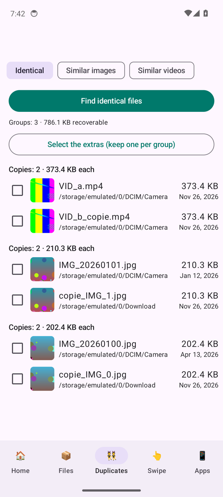

[English](README.md) · [Română](README.ro.md) · [Français](README.fr.md) · **Italiano** · [Español](README.es.md) · [Português](README.pt.md) · [Deutsch](README.de.md) · [Magyar](README.hu.md)

# LUSTRUM

> **Riprenditi il telefono. Niente ne esce.**

LUSTRUM trova file inutili, duplicati, foto simili e residui di app, e li elimina solo con il tuo consenso. Non ha il permesso INTERNET, quindi non può inviare nulla da nessuna parte.

**Versione: 0.8.0 · Ultimo aggiornamento: 2026-11-26**

[lustrum.chiuta.ro/](https://lustrum.chiuta.ro/)

## Cosa fa

- **Archiviazione a colpo d'occhio** — Spazio usato e libero, suddiviso in immagini, video, audio, documenti e archivi.
- **File grandi, vecchi e inutili** — File oltre 50 MB, intatti da un anno, temporanei, miniature, cestino e download interrotti.
- **Duplicati esatti** — Confrontati per dimensione, poi impronta rapida, poi SHA-256 completo. Per impostazione predefinita resta la copia più vecchia.
- **Foto simili** — L'hash percettivo trova scatti ridimensionati, risalvati o ripetuti, raggruppati senza concatenazioni. Controlli tu ogni gruppo; per impostazione predefinita si tiene la copia più grande.
- **Residui di app** — Cartelle lasciate da app disinstallate da tempo, più le cartelle vuote.
- **Compressione foto** — Ricodifica i JPEG grandi e li sostituisce solo se il risultato è almeno il 20% più leggero. L'EXIF si conserva; Motion Photo e foto HDR vengono saltate.
- **App, cache e inutilizzate** — Dimensione della cache per app, data dell'ultimo utilizzo, accesso diretto alle impostazioni o alla disinstallazione.
- **Stato del dispositivo** — RAM, livello e temperatura della batteria — sola lettura, a scopo informativo.
- **Foto sfocate e scure** — Misura nitidezza e luminosità su una piccola copia di ogni foto ed elenca i probabili scarti, da verificare.
- **Eliminazione sicura con annullamento** — Cestino LUSTRUM opzionale: i file eliminati attendono 30 giorni e si possono ripristinare; lo spazio si libera allo svuotamento.
- **Anteprime e cartelle più grandi** — Miniature in ogni elenco, una classifica delle cartelle che occupano più spazio e il totale liberato finora.
- **Swiper** — Scorri foto e video uno a uno, dai più vecchi: scorri a sinistra per eliminare, a destra per tenere. Nulla viene rimosso finché non confermi alla fine.
- **Pulizia programmata** — Ogni settimana o mese, in background, con batteria adeguata: una notifica, oppure la pulizia automatica dei soli file inutili evidenti più vecchi di 24 ore. I file puliti vanno sempre prima nel cestino LUSTRUM di 30 giorni.
- **Foto migliore e video simili** — In ogni gruppo di foto simili viene proposta per prima la copia più nitida. I video simili sono individuati da un fotogramma centrale e da una durata quasi identica.
- **Riduzione della cache assistita dal sistema** — Chiede ad Android di liberare la cache delle altre app richiedendo spazio. Il risultato varia da dispositivo a dispositivo; nessuna magia da root. Sui telefoni con root usa anche il root per svuotare tutte le cache.

## Guardalo in azione

Screenshot e registrazioni reali di LUSTRUM su un emulatore Android con file di esempio generati — non su un telefono fisico.

**Brevi video dimostrativi:** [▶ Scansione del telefono](media/scan.mp4) · [▶ Ricerca dei duplicati](media/dupes.mp4) · [▶ Swiper in azione](media/swiper.mp4) · [▶ Programmare la pulizia automatica](media/schedule.mp4)

## Privato per costruzione

La maggior parte dei pulitori vive di pubblicità e dati. LUSTRUM è fatto al contrario.

- Nessun permesso INTERNET nel manifest — lo verifichi nelle info dell'app del sistema.
- Niente account, analisi, pubblicità o richieste di pagamento.
- Ogni eliminazione è confermata; per i contenuti multimediali interviene la finestra di dialogo di Android.
- Controlli di sicurezza integrati: le Motion Photo e le foto HDR non vengono mai ricompresse, i file modificati nelle ultime 24 ore non sono mai considerati inutili e nulla fuori dall'archiviazione condivisa può essere eliminato.
- La pulizia programmata agisce solo sui file inutili evidenti più vecchi di 24 ore e li sposta sempre prima nel cestino LUSTRUM, mai direttamente all'eliminazione.

## Il confronto

Con i pulitori più noti, in base alle loro descrizioni pubbliche (novembre 2026). Le celle dei concorrenti provengono da descrizioni pubbliche e non sono state testate da noi. La compressione di LUSTRUM (solo JPEG) e la pianificazione (solo file inutili evidenti) sono parziali; strumenti maturi come SD Maid SE fanno di più.

| | LUSTRUM | CCleaner | SD Maid SE | Files by Google | Norton Clean / Avast Cleanup |
|---|:---:|:---:|:---:|:---:|:---:|
| Senza pubblicità | ✓ | ✗ | ✓ | ✓ | ✗ |
| Senza accesso a internet né telemetria | ✓ | ✗ | ~ | ✗ | ✗ |
| Open source | ✓ | ✗ | ✓ | ✗ | ✗ |
| Duplicati e foto simili | ✓ | ~ | ✓ | ~ | ✓ |
| Residui di app disinstallate | ~ | ✓ | ✓ | ✗ | ~ |
| Compressione foto | ~ | ✓ | ✓ | ✗ | ~ |
| Pulizia programmata | ~ | ~ | ✓ | ✗ | ✓ |
| «Boost RAM» | ~ | ✓ | ✗ | ✗ | ✓ |
| Supporto root / Shizuku | ~ | ✗ | ✓ | ✗ | ✗ |

✓ sì · ~ parziale o a pagamento · ✗ no · — assente, di proposito

## Cosa non fa — di proposito

- Il «boost RAM» e i chiusori di app in background. Android gestisce da solo la memoria; questi pulsanti non servono e scaricano la batteria.
- Svuotare con certezza, con un tocco, la cache delle altre app. Android lo vieta senza privilegi speciali; LUSTRUM offre una riduzione assistita dal sistema (risultati variabili) e rimanda alla schermata di archiviazione di ogni app.
- iOS. Il sistema non consente pulizie fuori dall'area riservata dell'app.
- Automazione aggressiva in background. La pulizia programmata tocca solo i file inutili evidenti più vecchi di 24 ore, mai le tue foto o i documenti.
- Guardare nelle cartelle Android/data delle altre app. Android 11+ lo vieta a ogni app normale; solo root o Shizuku possono. LUSTRUM usa il root solo per la riduzione della cache e non supporta Shizuku.

## I permessi, in parole semplici

| Permesso | Perché |
|---|---|
| Contenuti multimediali | Analizza foto, video e audio. Per eliminare, Android chiede conferma. |
| Accesso a tutti i file (facoltativo) | Documenti, file inutili, residui, cartelle vuote e compressione. |
| Accesso ai dati di utilizzo (facoltativo) | Dimensione della cache per app e data dell'ultimo utilizzo. |
| Rimozione pacchetti | Consente di disinstallare un'app dall'elenco. |

## Ottieni LUSTRUM

Beta — versione 0.8.0. Si installa direttamente, senza account di uno store.

1. Scarica l'APK dall'ultima versione pubblicata.
2. Consenti l'installazione da questa fonte quando Android lo chiede.
3. Apri LUSTRUM, concedi l'accesso ai contenuti multimediali e tocca Scansiona. Un accesso extra facoltativo sblocca documenti, residui e compressione.

## Compilazione

JDK 21, Android SDK, Gradle 8.14+: esegui `gradle assembleRelease` (`gradle testDebugUnitTest` esegue i test unitari). L'APK compare in `app/build/outputs/apk/release/`. Il workflow Build APK testa, compila e pubblica una release per ogni nuova versione su main. Gli APK sono firmati con una chiave pubblica stabile nel repository (`tools/lustrum-public.jks`), quindi gli aggiornamenti si installano sopra; per una tua distribuzione aggiungi la tua chiave come secret del repository (`LUSTRUM_KEYSTORE_B64`, `LUSTRUM_STORE_PASS`, `LUSTRUM_KEY_PASS`, `LUSTRUM_KEY_ALIAS`).

## Stato

Beta. 25 test unitari, 11 test strumentati su emulatore Android e uno smoke test della build release minificata girano in CI; non ancora provato su un telefono fisico. Le traduzioni sono automatiche e non riviste da madrelingua. Le versioni dalla 0.4.0 condividono la chiave di firma: gli aggiornamenti si installano sopra (da 0.3.0 o precedenti, disinstalla una volta).

---

Rilasciato con licenza MIT. © 2026 Alexandru-Ionuț Chiuță (Alexio)
