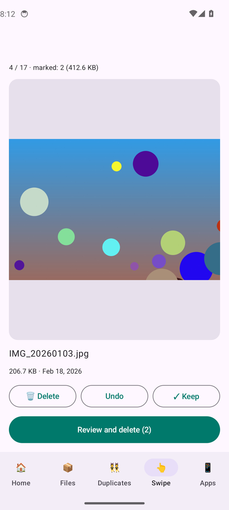

**English** · [Română](README.ro.md) · [Français](README.fr.md) · [Italiano](README.it.md) · [Español](README.es.md) · [Português](README.pt.md) · [Deutsch](README.de.md) · [Magyar](README.hu.md)

# LUSTRUM

> **Reclaim your phone. Nothing leaves it.**

LUSTRUM finds junk, duplicates, look-alike photos and app leftovers — and clears them only with your approval. It has no INTERNET permission, so it physically cannot send anything anywhere.

**Version: 0.8.0 · Last updated: 2026-11-26**

[lustrum.chiuta.ro/](https://lustrum.chiuta.ro/)

## What it does

- **Storage at a glance** — Used and free space, broken down by images, video, audio, documents and archives.
- **Large, old & junk files** — Files over 50 MB, untouched for a year, temp files, thumbnails, trash and interrupted downloads.
- **Exact duplicates** — Matched by size, then a quick fingerprint, then full SHA-256. The oldest copy is kept by default.
- **Look-alike photos** — Perceptual hashing finds resized, re-saved and repeated shots, grouped without chaining. You review each group; the largest copy is kept by default.
- **App leftovers** — Folders left behind by apps you uninstalled long ago, plus empty folders.
- **Photo compression** — Re-encodes big JPEGs and replaces them only if the result is at least 20% smaller. EXIF is kept; Motion Photos and HDR shots are skipped.
- **Apps, caches & unused** — Cache size per app, last-used date, one tap to its settings or to uninstall.
- **Device status** — RAM, battery level and temperature — read-only, for information.
- **Blurry & dark photos** — Measures sharpness and brightness on a small copy of each photo and lists the likely rejects for you to review.
- **Safe delete with undo** — Optional LUSTRUM trash: deleted files wait 30 days and can be restored; space is freed when you empty it.
- **Previews & biggest folders** — Thumbnails in every list, a ranking of the folders that eat your storage, and a running total of what you have freed.
- **Swiper** — Go through photos and videos one by one, oldest first: swipe left to delete, right to keep. Nothing is removed until you confirm at the end.
- **Scheduled cleaning** — Weekly or monthly, in the background, on a good battery: a notification, or automatic clean-up of obvious junk older than 24 hours only. Cleaned files always go to the 30-day LUSTRUM trash first.
- **Best photo & similar videos** — In each look-alike group the sharpest copy is suggested first. Similar videos are matched by a middle frame and near-identical length.
- **System-assisted cache trim** — Asks Android to free other apps' cached data by requesting storage. Results vary by device; there is no root-level magic. On rooted phones it also uses root to clear all caches.

## See it in action

Real screenshots and screen recordings of LUSTRUM running on an Android emulator with generated sample files — not on a physical phone.

**Short demo videos:** [▶ Scanning the phone](media/scan.mp4) · [▶ Finding duplicates](media/dupes.mp4) · [▶ Swiper in action](media/swiper.mp4) · [▶ Scheduling automatic cleaning](media/schedule.mp4)

## Private by construction

Most cleaners earn their keep from ads and data. LUSTRUM is built the other way around.

- No INTERNET permission in the manifest — you can verify it in your system's app info.
- No accounts, no analytics, no ads, no purchase prompts.
- Every deletion is confirmed first; media deletions go through Android's own system dialog.
- Built-in safety checks: Motion Photos and HDR photos are never recompressed, files changed in the last 24 hours are never called junk, and nothing outside shared storage can be deleted.
- Scheduled cleaning acts only on obvious junk older than 24 hours and always moves it to the LUSTRUM trash first, never straight to deletion.

## How it compares

Against the best-known cleaners, based on their public descriptions (November 2026). Competitor cells come from public descriptions and were not tested by us. LUSTRUM's compression (JPEG only) and scheduling (obvious junk only) are partial; mature tools such as SD Maid SE do more.

| | LUSTRUM | CCleaner | SD Maid SE | Files by Google | Norton Clean / Avast Cleanup |
|---|:---:|:---:|:---:|:---:|:---:|
| No ads | ✓ | ✗ | ✓ | ✓ | ✗ |
| No internet access or telemetry | ✓ | ✗ | ~ | ✗ | ✗ |
| Open source | ✓ | ✗ | ✓ | ✗ | ✗ |
| Duplicates & look-alike photos | ✓ | ~ | ✓ | ~ | ✓ |
| Leftovers of uninstalled apps | ~ | ✓ | ✓ | ✗ | ~ |
| Photo compression | ~ | ✓ | ✓ | ✗ | ~ |
| Scheduled cleaning | ~ | ~ | ✓ | ✗ | ✓ |
| “RAM boost” | ~ | ✓ | ✗ | ✗ | ✓ |
| Root / Shizuku support | ~ | ✗ | ✓ | ✗ | ✗ |

✓ yes · ~ partial or paid · ✗ no · — not offered, on purpose

## What it will not do — on purpose

- “RAM boost” and background-app killers. Android manages memory itself; these buttons don't help and drain the battery.
- Guaranteed one-tap clearing of other apps' caches. Android forbids it without special privileges; LUSTRUM offers a system-assisted trim (results vary) and links to each app's storage screen.
- iOS. The system does not allow cleaning outside an app's own sandbox.
- Aggressive background automation. Scheduled cleaning only touches obvious junk older than 24 hours, never your photos or documents.
- Look inside other apps' Android/data folders. Android 11+ blocks this for every normal app; only root or Shizuku can. LUSTRUM uses root only for the cache trim and does not support Shizuku.

## Permissions, in plain words

| Permission | Why |
|---|---|
| Media | Scans photos, video and audio. Deleting asks Android for confirmation. |
| All files access (optional) | Documents, junk, leftovers, empty folders and compression. |
| Usage access (optional) | Cache size per app and when each app was last used. |
| Package removal | Lets you uninstall an app from the list. |

## Get LUSTRUM

Beta — version 0.8.0. Installs directly; no store account needed.

1. Download the APK from the latest release.
2. Allow installation from this source when Android asks.
3. Open LUSTRUM, grant media access and tap Scan. Optional extra access unlocks documents, leftovers and compression.

## Building

JDK 21, Android SDK, Gradle 8.14+: run `gradle assembleRelease` (`gradle testDebugUnitTest` runs the unit tests). The APK appears in `app/build/outputs/apk/release/`. The Build APK workflow tests, builds and publishes a release for every new version pushed to main. APKs are signed with a stable public key kept in the repository (`tools/lustrum-public.jks`), so updates install over each other; for your own distribution add your key as repository secrets (`LUSTRUM_KEYSTORE_B64`, `LUSTRUM_STORE_PASS`, `LUSTRUM_KEY_PASS`, `LUSTRUM_KEY_ALIAS`).

## Status

Beta. 25 unit tests, 11 instrumented tests on an Android emulator and a smoke test of the minified release build run in CI; not yet tested on a physical phone. Translations are machine-made and not reviewed by native speakers. Builds from 0.4.0 on share one signing key, so updates install over the old version (from 0.3.0 or earlier, uninstall once).

---

Released under the MIT licence. © 2026 Alexandru-Ionuț Chiuță (Alexio)
