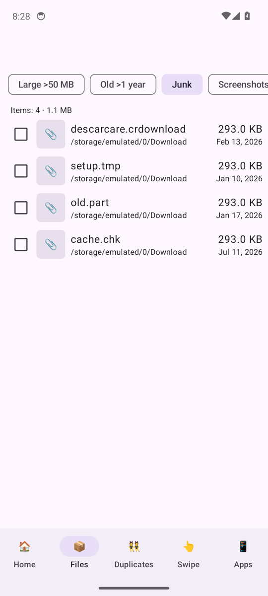

[English](README.md) · [Română](README.ro.md) · [Français](README.fr.md) · [Italiano](README.it.md) · [Español](README.es.md) · **Português** · [Deutsch](README.de.md) · [Magyar](README.hu.md)

# LUSTRUM

> **Recupere seu celular. Nada sai dele.**

O LUSTRUM encontra arquivos inúteis, duplicatas, fotos parecidas e sobras de aplicativos, e só os apaga com a sua autorização. Ele não tem a permissão INTERNET, então não consegue enviar nada para lugar nenhum.

**Versão: 0.8.0 · Última atualização: 2026-11-26**

[lustrum.chiuta.ro/](https://lustrum.chiuta.ro/)

## O que faz

- **Armazenamento num relance** — Espaço usado e livre, dividido em imagens, vídeo, áudio, documentos e arquivos compactados.
- **Arquivos grandes, antigos e inúteis** — Arquivos acima de 50 MB, parados há um ano, temporários, miniaturas, lixeira e downloads interrompidos.
- **Duplicatas exatas** — Comparadas por tamanho, depois impressão rápida e depois SHA-256 completo. Por padrão, a cópia mais antiga é mantida.
- **Fotos parecidas** — O hash perceptual encontra fotos redimensionadas, salvas de novo ou repetidas, agrupadas sem encadeamento. Você revisa cada grupo; por padrão a maior cópia é mantida.
- **Sobras de aplicativos** — Pastas deixadas por aplicativos desinstalados há muito tempo, além de pastas vazias.
- **Compressão de fotos** — Recodifica JPEGs grandes e só os substitui se o resultado for pelo menos 20% menor. O EXIF é mantido; Motion Photos e fotos HDR são ignoradas.
- **Apps, caches e sem uso** — Tamanho do cache por app, data do último uso e acesso direto às configurações ou à desinstalação.
- **Estado do dispositivo** — RAM, nível e temperatura da bateria — somente leitura, apenas informativo.
- **Fotos tremidas e escuras** — Mede nitidez e brilho em uma cópia pequena de cada foto e lista os prováveis descartes para você revisar.
- **Exclusão segura com desfazer** — Lixeira LUSTRUM opcional: os arquivos excluídos esperam 30 dias e podem ser restaurados; o espaço é liberado ao esvaziá-la.
- **Prévias e maiores pastas** — Miniaturas em cada lista, um ranking das pastas que mais ocupam espaço e o total liberado até agora.
- **Swiper** — Revise fotos e vídeos um a um, começando pelos mais antigos: deslize para a esquerda para excluir, para a direita para manter. Nada é removido até você confirmar no final.
- **Limpeza agendada** — Semanal ou mensal, em segundo plano, com bateria suficiente: uma notificação, ou limpeza automática apenas do lixo óbvio com mais de 24 horas. Os arquivos limpos vão sempre primeiro para a lixeira LUSTRUM de 30 dias.
- **Melhor foto e vídeos parecidos** — Em cada grupo de fotos parecidas, a cópia mais nítida é sugerida primeiro. Vídeos parecidos são identificados por um quadro do meio e duração quase idêntica.
- **Redução de cache assistida pelo sistema** — Pede ao Android que libere o cache de outros apps solicitando espaço. O resultado varia conforme o aparelho; sem mágica de root. Em telefones com root também usa root para limpar todos os caches.

## Veja em ação

Capturas e gravações reais do LUSTRUM em um emulador Android com arquivos de exemplo gerados — não em um telefone físico.

**Vídeos de demonstração curtos:** [▶ Verificando o telefone](media/scan.mp4) · [▶ Procurando duplicatas](media/dupes.mp4) · [▶ Swiper em ação](media/swiper.mp4) · [▶ Agendando a limpeza automática](media/schedule.mp4)

## Privado por construção

A maioria dos limpadores vive de anúncios e dados. O LUSTRUM foi feito ao contrário.

- Sem a permissão INTERNET no manifesto — você confere nas informações do app no sistema.
- Sem contas, análises, anúncios ou pedidos de pagamento.
- Toda exclusão é confirmada; nas mídias, quem confirma é a caixa de diálogo do próprio Android.
- Verificações de segurança integradas: Motion Photos e fotos HDR nunca são recomprimidas, arquivos alterados nas últimas 24 horas nunca são tratados como lixo e nada fora do armazenamento compartilhado pode ser excluído.
- A limpeza agendada atua só sobre lixo óbvio com mais de 24 horas e o move sempre primeiro para a lixeira LUSTRUM, nunca direto para a exclusão.

## Como se compara

Com os limpadores mais conhecidos, com base nas descrições públicas deles (novembro de 2026). As células dos concorrentes vêm de descrições públicas e não foram testadas por nós. A compressão do LUSTRUM (só JPEG) e o agendamento (só lixo óbvio) são parciais; ferramentas maduras como o SD Maid SE fazem mais.

| | LUSTRUM | CCleaner | SD Maid SE | Files by Google | Norton Clean / Avast Cleanup |
|---|:---:|:---:|:---:|:---:|:---:|
| Sem anúncios | ✓ | ✗ | ✓ | ✓ | ✗ |
| Sem acesso à internet nem telemetria | ✓ | ✗ | ~ | ✗ | ✗ |
| Código aberto | ✓ | ✗ | ✓ | ✗ | ✗ |
| Duplicatas e fotos parecidas | ✓ | ~ | ✓ | ~ | ✓ |
| Sobras de apps desinstalados | ~ | ✓ | ✓ | ✗ | ~ |
| Compressão de fotos | ~ | ✓ | ✓ | ✗ | ~ |
| Limpeza agendada | ~ | ~ | ✓ | ✗ | ✓ |
| “Turbo de RAM” | ~ | ✓ | ✗ | ✗ | ✓ |
| Suporte a root / Shizuku | ~ | ✗ | ✓ | ✗ | ✗ |

✓ sim · ~ parcial ou pago · ✗ não · — não oferece, de propósito

## O que ele não faz — de propósito

- “Turbo de RAM” e fechadores de apps em segundo plano. O Android gerencia a memória sozinho; esses botões não ajudam e gastam bateria.
- Limpar com garantia, em um toque, o cache de outros apps. O Android proíbe sem privilégios especiais; o LUSTRUM oferece uma redução assistida pelo sistema (resultados variáveis) e leva à tela de armazenamento de cada app.
- iOS. O sistema não permite limpeza fora do espaço do próprio app.
- Automação agressiva em segundo plano. A limpeza agendada só toca em lixo óbvio com mais de 24 horas, nunca em suas fotos ou documentos.
- Olhar dentro das pastas Android/data de outros apps. O Android 11+ bloqueia isso para qualquer app comum; só root ou Shizuku conseguem. O LUSTRUM usa root apenas para reduzir o cache e não suporta Shizuku.

## As permissões, em palavras simples

| Permissão | Para quê |
|---|---|
| Mídia | Verifica fotos, vídeo e áudio. Para apagar, o Android pede confirmação. |
| Acesso a todos os arquivos (opcional) | Documentos, lixo, sobras, pastas vazias e compressão. |
| Acesso ao uso de apps (opcional) | Tamanho do cache por app e quando foi usado pela última vez. |
| Remoção de pacotes | Permite desinstalar um app pela lista. |

## Baixe o LUSTRUM

Beta — versão 0.8.0. Instalação direta, sem conta de loja.

1. Baixe o APK na última versão publicada.
2. Permita a instalação desta fonte quando o Android perguntar.
3. Abra o LUSTRUM, conceda acesso às mídias e toque em Verificar. Um acesso extra opcional libera documentos, sobras e compressão.

## Compilação

JDK 21, Android SDK, Gradle 8.14+: execute `gradle assembleRelease` (`gradle testDebugUnitTest` roda os testes unitários). O APK aparece em `app/build/outputs/apk/release/`. O workflow Build APK testa, compila e publica uma versão a cada nova versão enviada para main. Os APKs são assinados com uma chave pública estável do repositório (`tools/lustrum-public.jks`), então as atualizações se instalam por cima; para sua própria distribuição, adicione sua chave como segredos do repositório (`LUSTRUM_KEYSTORE_B64`, `LUSTRUM_STORE_PASS`, `LUSTRUM_KEY_PASS`, `LUSTRUM_KEY_ALIAS`).

## Situação

Beta. 23 testes unitários, 10 instrumentados em um emulador Android e um teste de fumaça da versão release minificada rodam no CI; ainda não testado em um telefone físico. As traduções são automáticas e não revisadas por nativos. As versões desde 0.4.0 compartilham a chave de assinatura: as atualizações instalam por cima (de 0.3.0 ou anteriores, desinstale uma vez).

---

Publicado sob a licença MIT. © 2026 Alexandru-Ionuț Chiuță (Alexio)
